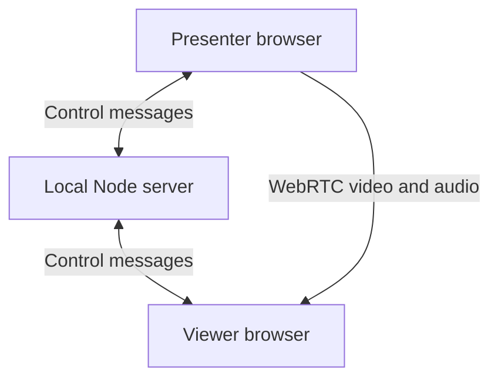
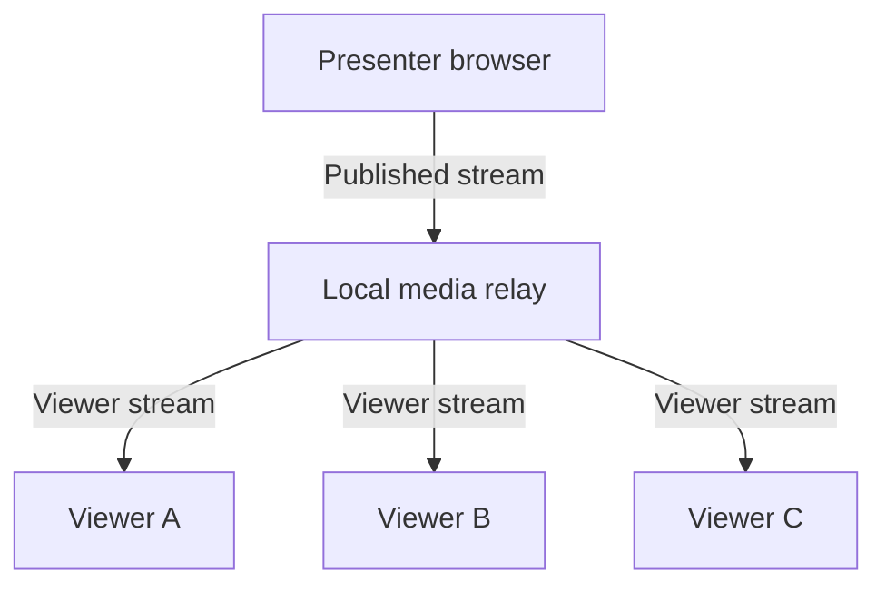

# LocalStage — Local Network Presentation App

Product plan, interface layout, technical backbone, and development prompt  
Prepared: October 19, 2026  
Status: proposed design; the streaming application has not been built or benchmarked.

Latest requirement: switch to a still image after 5 continuous seconds without visual changes, then resume live video when a change is detected.

Added requirement: upload PPT/PPTX/PDF presentations, synchronize the presenter's current slide, and let each viewer review earlier slides in a labeled split view without navigating beyond the presenter's current slide.

## 1. What you are building

LocalStage is a screen-sharing app for people connected to the same local Wi-Fi, hotspot, or reachable wired network. The presenter runs a small server on their laptop and chooses a screen, window, or browser tab to share. Viewers open the laptop's local IP address in a browser and watch the live presentation.

Only the presenter's computer needs to run the local app. Viewers do not install an app or create accounts. Once the software and its dependencies are installed, the presentation must work with the internet connection disconnected while the local network remains active.

Initial assumptions:

- One desktop or laptop presenter per session, initially tested on Windows with Chrome or Edge.
- Viewers use laptops, phones, or tablets. Mobile screen broadcasting is outside the first release.
- Build and validate one presenter plus one viewer first; then test 3 and 5 viewers. Start with a configurable cap of 5. This is a proposed test target, not a proven capacity claim.
- Begin with live screen video. Add captured audio only where the browser and operating system provide it.
- Include an uploaded-deck presentation mode and independent, bounded viewer review. Support PDF, PPTX, and PPT through a local rendering/conversion pipeline; other document types can be added later.
- If an entire classroom is the first real use case, evaluate a local media relay before declaring the app ready for that audience.

## 2. The experience

### Presenter

1. Connect the laptop to the Wi-Fi/router, or enable its hotspot.
2. Launch LocalStage. Its local server starts and identifies available network interfaces.
3. Choose the Wi-Fi, Ethernet, or hotspot adapter that viewers will use.
4. The app opens the presenter page on a loopback address, such as `http://localhost:3000/host`.
5. Create a session, enter a title, and optionally enable a six-digit join PIN.
6. Click **Start sharing**, then select a screen, application window, or tab in the browser's capture picker.
7. Show viewers the local join address and its QR code.
8. Monitor the preview and connected viewers. Stop sharing when finished.

### Viewer

1. Connect to the same Wi-Fi or hotspot as the presenter.
2. Open the displayed address, for example `http://192.168.137.1:3000`.
3. Enter the join PIN if enabled, then tap **Watch presentation**.
4. Watch the stream, use fullscreen where supported, and enable audio if available.
5. See a clear waiting, reconnecting, paused, or ended screen when appropriate.

All addresses above are examples. The real address must come from the selected network adapter. `localhost` on a viewer's phone refers to that phone, so viewers must use the laptop's LAN address.

Supported network arrangements to test:

| Arrangement | How it works | Main check |
| --- | --- | --- |
| Shared router | Laptop and viewers connect to the same router | Devices must be allowed to communicate |
| Laptop hotspot | Laptop hosts both the app and the hotspot | Hotspot adapter address, firewall, and client capacity |
| Phone hotspot | Laptop and viewers connect to the phone | Hotspot must allow communication between its clients |
| Wired presenter plus Wi-Fi viewers | Laptop uses Ethernet; viewers use the router's Wi-Fi | Both sides must be in reachable network segments |

Being on the same Wi-Fi name does not guarantee reachability. Guest Wi-Fi, client isolation, VLAN rules, and hotspot restrictions can prevent device-to-device traffic. Treat a phone hotspot as a configuration to test, not a universal guarantee.

## 3. Why the presenter uses localhost

Browser screen capture uses `navigator.mediaDevices.getDisplayMedia()`. It needs a secure context and a user action. Browsers treat loopback/localhost as trustworthy even over HTTP; an ordinary HTTP LAN address does not get the same treatment. The browser prompts the presenter to choose what to share each time capture starts. [S1, S2]

Recommended first implementation:

| Role | Example address | Behavior |
| --- | --- | --- |
| Presenter | `http://localhost:3000/host` | Starts capture and controls the session |
| Viewer | `http://192.168.137.1:3000` | Joins and receives media; never requests screen, microphone, or camera capture |

Receive-only WebRTC does not use `getDisplayMedia()` or `getUserMedia()`. Validate the HTTP viewer path on every browser you intend to support. Keep the viewer page, API, and WebSocket on the same LAN origin. Do not promise universal browser compatibility before testing.

For a hardened deployment, support HTTPS/WSS with certificates trusted by the participating devices. Certificate setup is a separate deployment task; a random self-signed certificate is not a frictionless solution. Never instruct users to disable browser security or bypass capture permissions.

## 4. Interface layout

Use a restrained presentation-focused design: a dark video area, readable controls, clear live/paused/ended states, and a single obvious primary action. Let the stream occupy most of the viewer screen. Bundle fonts and icons locally.

### Screen A — Setup

- Header: LocalStage name and local server status.
- Main form: presentation title, network adapter, optional join PIN.
- Source choice: Share screen or Upload presentation. Accept PDF/PPTX/PPT, show local processing progress, and let the presenter check converted slides before starting.
- Address area: actual viewer URL, copy button, locally generated QR code.
- Primary action: **Start sharing**.
- Inline help: same-network instruction and a link to connection troubleshooting.

Do not request Wi-Fi passwords. Connecting to or creating a hotspot remains an operating-system task in the first version.

### Screen B — Presenter dashboard

| Area | Contents |
| --- | --- |
| Top bar | Session title, sharing state, viewer count, end button |
| Main left area | Large muted preview of the selected source |
| Controls below preview | Pause/resume, change source, available audio control, quality preset |
| Automatic still mode | On by default; 5-second delay; Live video / Still image indicator; Always live override |
| Right panel | Viewer address, QR code, PIN, lock/unlock joining |
| Viewer panel | Connected viewers, connection state, remove action |
| Uploaded presentation | File name, slide thumbnails, current slide number, Previous/Next, and keyboard navigation |
| Status details | Actual connection warnings and available WebRTC statistics |

At desktop widths, use roughly two-thirds of the content width for the preview and one-third for joining and viewer controls. Stack the side panel below the preview on narrow screens.

Preview and outgoing media must reflect the same sharing state. Pausing only the local preview is not a valid pause implementation.

### Screen C — Viewer join page

- Presentation title.
- Optional name field; use a generated label if omitted.
- PIN field only when required.
- **Watch presentation** button.
- Clear errors: incorrect PIN, session full, joining locked, host unavailable.

The join button provides a deliberate interaction for playback. Still handle `video.play()` rejection and show a separate tap-to-play or enable-audio control when required. [S6]

### Screen D — Viewer playback

- Compact header with title and connection state.
- Large video element using `object-fit: contain`; never crop a shared slide by default.
- Small controls for fit/fullscreen, audio, and leaving.
- Mobile landscape support and usable touch targets.
- State overlays for waiting, paused, reconnecting, and ended.
- A subtle Live video / Still image indicator; a still image continues to show the shared screen and is separate from a manual privacy pause.
- An expand-in-page fallback when native fullscreen is unavailable.
- Follow presenter is the default. Selecting an earlier uploaded slide opens a split layout: **Presenter — Live** on the left and **Your Review** on the right. Each pane shows its own slide number; only the review pane has independent slide controls. **Back to Live** returns to one synchronized pane. On narrow screens, stack the live pane above review without hiding either.

### Screen E — Connection help

Distinguish **page will not open** from **page opens but video will not connect**. The first usually points toward address/reachability/server issues; the second calls for WebRTC, media-port, or browser investigation. Show the actual address, adapter, and port without inventing a diagnosis.

## 5. Technical backbone

Recommended stack:

| Layer | Choice | Responsibility |
| --- | --- | --- |
| Frontend | React + TypeScript + Vite | Presenter and viewer interfaces |
| Local backend | Node.js + TypeScript + Express | Serve built assets and session endpoints |
| Signaling | WebSocket using `ws` | Join messages, offers, answers, ICE candidates, session events |
| Screen capture | `getDisplayMedia()` | Obtain the presenter's selected video and optional audio tracks |
| Media transport | Native WebRTC `RTCPeerConnection` | Low-latency audio/video transport |
| Still-image delivery | Reliable `RTCDataChannel` | One snapshot per stable screen for each viewer |
| Change detection | Local captured-frame comparison | Detect visual stillness and resume video on a change |
| Presentation import | Local LibreOffice conversion and PDF page rendering | Turn PPT/PPTX/PDF into individually served slide assets |
| Slide synchronization | Server-authorized WebSocket state | Track the host's current slide, deck revision, and navigation limit |
| Viewer review | Independent browser state | Browse earlier slides while preserving the live presenter pane |
| State | In-memory session store | One active session, viewers, permissions, lifecycle |
| Join QR | Locally bundled QR library | Encode the actual LAN viewer URL |
| Later distribution | Packaged local launcher or desktop shell | Start server and open presenter page |

Vite is the build tool. In a release, Express serves the compiled frontend. Viewers should not depend on a Vite development server or an internet-hosted frontend.

No database is necessary for the initial app. Add local settings persistence only when needed. Session secrets and active membership remain short-lived.

Uploaded originals and converted slide assets may use a private local session directory with an explicit cleanup/retention policy. They stay on the presenter/server machine. Keep presentation originals outside the static web root; viewers receive authorized slide assets rather than an unrestricted copy of the whole file.

### Control messages and media take different paths



The local server introduces and authorizes participants. WebRTC carries media directly between the presenter and each viewer in the initial version. Signaling is an application responsibility and can use WebSockets. [S3]

Do not send a continuous series of screenshots through WebSocket as the core streaming design. WebRTC provides the media transport, negotiation, and feedback mechanisms for this use case.

### Connection sequence

1. Local launcher starts the server and opens an authenticated host session on loopback.
2. Host creates a presentation session.
3. A user click starts browser capture.
4. Viewer requests to join through the local server.
5. Server validates session state, PIN, capacity, and membership, then assigns the viewer an ID.
6. Presenter creates one `RTCPeerConnection` for that viewer and attaches the current tracks.
7. Presenter sends an offer; viewer sets it as the remote description and returns an answer.
8. Both sides exchange ICE candidates through the server. Queue candidates until the remote description exists.
9. Viewer receives tracks and attaches the incoming stream to its video element.
10. On departure or session end, close peer connections and remove listeners, timers, and membership.

Use the presenter as the offerer to reduce negotiation collisions. Include a session ID and connection-generation ID in signaling messages so stale messages from an earlier connection cannot alter a replacement connection.

### Local network configuration

- Obtain adapter addresses with Node's `os.networkInterfaces()`; show valid choices and let the presenter select the intended interface. [S7]
- Bind the presenter service to loopback and the audience service to the chosen LAN IPv4 address. They may share one process and session store. Bind IPv6 loopback as needed for `localhost`, or open the exact `127.0.0.1` address that is bound.
- Serve the viewer HTML, assets, API, and WebSocket from the same LAN origin.
- Begin with `new RTCPeerConnection({ iceServers: [] })` for direct local connectivity. Do not add public STUN, TURN, cloud signaling, or analytics.
- No external ICE servers does not guarantee connectivity. Browser candidate privacy/mDNS behavior, VPNs, firewalls, and network isolation must be tested.
- WebRTC media can use dynamically negotiated ports. Opening only the web server's TCP port may make the page load while video still fails.
- Use firewall rules scoped to the intended local network. Browser JavaScript does not provide a portable hard binding of WebRTC to one chosen adapter; the server bind alone is not a complete media-network restriction.
- Keep router port forwarding, public tunnels, and automatic UPnP mapping out of the app. Local-only behavior depends on network/firewall configuration as well as code.
- If the adapter or IP changes, stop or explicitly reconfigure the session and regenerate the address and QR code.
- Respect browser local-network permission prompts where applicable. Test current browser policy; do not work around it by disabling security. [S8]

### Trust and access

- Host authorization must be enforced on the server, not inferred from a URL or hidden button.
- Use a short-lived host bootstrap secret issued by the local launcher, exchanged only on the loopback service. Do not place host credentials in the viewer URL or QR code.
- Enforce message schemas, role checks, session membership, permitted signaling targets, origin checks, and message-size limits.
- Rate-limit PIN attempts. A six-digit PIN is a lightweight join gate, not strong authentication against a hostile network.
- Locking the room prevents new joins; existing viewers remain connected.
- Removing a viewer revokes their current membership/token and closes their media connection. Preventing them from returning as a new participant requires approval or stronger identity controls.
- WebRTC encrypts its media transport. Plain HTTP/WS does not protect the page, join PIN, or signaling from an active network attacker. Keep the HTTP prototype on a trusted local network; use trusted HTTPS/WSS for stronger protection. [S3]

## 6. Code organization

Use this as the logical repository structure, not a claim that these files already exist:

| Path | Responsibility |
| --- | --- |
| `apps/server/src/index.ts` | Startup, listener configuration, shutdown |
| `apps/server/src/network.ts` | Adapter enumeration and selected address |
| `apps/server/src/http.ts` | Static assets and HTTP endpoints |
| `apps/server/src/signaling.ts` | WebSocket authentication and message routing |
| `apps/server/src/session-store.ts` | Session and viewer lifecycle |
| `apps/server/src/auth.ts` | Host bootstrap, join tokens, PIN rate limits |
| `apps/server/src/decks.ts` | Presenter uploads, deck metadata, activation and replacement |
| `apps/server/src/deck-converter.ts` | Local conversion/rendering jobs and private output storage |
| `apps/server/src/slide-access.ts` | Authorize individual slide and thumbnail requests |
| `apps/web/src/pages/HostPage.tsx` | Setup and presenter dashboard |
| `apps/web/src/pages/JoinPage.tsx` | Viewer admission |
| `apps/web/src/pages/ViewerPage.tsx` | Playback and connection states |
| `apps/web/src/components/DeckPresenter.tsx` | Upload preview, thumbnails, and authoritative slide controls |
| `apps/web/src/components/SplitReview.tsx` | Labeled live/review panes and Back to Live |
| `apps/web/src/deck/review-state.ts` | Follow/review transitions, current-slide cap, and resynchronization |
| `apps/web/src/media/capture.ts` | Capture start, change, pause, stop |
| `apps/web/src/media/change-detector.ts` | Frame comparison, five-second inactivity timer, detector health |
| `apps/web/src/media/still-mode.ts` | Live/static transitions and per-viewer acknowledgements |
| `apps/web/src/media/snapshot-channel.ts` | Encode, chunk, transfer, decode, and release snapshots |
| `apps/web/src/media/host-peers.ts` | One outgoing peer per viewer |
| `apps/web/src/media/viewer-peer.ts` | Receive-only peer lifecycle |
| `apps/web/src/media/stats.ts` | Bitrate, packet loss, frame and connection stats |
| `apps/web/src/net/signaling-client.ts` | WebSocket connection and retry handling |
| `apps/web/src/components/` | Preview, player, join card, viewers, controls |
| `packages/protocol/src/index.ts` | Shared message schemas and types |
| `docs/network-setup.md` | Router/hotspot/firewall troubleshooting |
| `docs/test-results.md` | Actual tested devices, browser versions, load results |

### Core state

```ts
type SessionStatus = "waiting" | "live" | "paused" | "ended";

interface Session {
  id: string;
  title: string;
  status: SessionStatus;
  joinLocked: boolean;
  maxViewers: number;
  createdAt: number;
}

interface Viewer {
  id: string;
  sessionId: string;
  displayName: string;
  state: "joining" | "connected" | "reconnecting" | "left";
  joinedAt: number;
}
```

Keep credentials and PIN verification data in separate server-private structures. Do not serialize them with the public session state.

### Protocol outline

| Message | Direction | Purpose |
| --- | --- | --- |
| `host:create` | Host → server | Create session |
| `viewer:join` | Viewer → server | Request admission |
| `viewer:accepted` | Server → viewer | Return scoped membership |
| `viewer:ready` | Server → host | Start a peer for an admitted viewer |
| `rtc:offer` | Host → viewer via server | Offer media connection |
| `rtc:answer` | Viewer → host via server | Answer the offer |
| `rtc:ice` | Both ways via server | Exchange connection candidates |
| `session:state` | Server → members | Publish waiting/live/paused/ended state |
| `deck:activate` | Host → server | Activate a converted deck and publish a new deck revision |
| `presenter:navigate` | Host → server | Request next/previous/jump; viewers cannot send this command |
| `deck:state` | Server → members | Authoritative deck revision, current slide, and state sequence |
| `host:lock` | Host → server | Change admission policy |
| `host:remove-viewer` | Host → server | Revoke current viewer membership |
| `host:end` | Host → server | End session |
| `viewer:left` | Server → host | Clean up the viewer's peer |

This table specifies intent. The shared protocol module must define and validate actual payloads and acknowledgements.

Add `visual:state` signaling for the host's target live/static mode, separately from session status. The peer data channel carries `snapshot:start`, bounded binary chunks, `snapshot:end`, and `snapshot:ready`. Include session, source-generation, mode-generation, and snapshot IDs. Validate the MIME type, dimensions, and total byte length. The viewer acknowledges only after decoding and displaying the complete image. Track each viewer's committed mode separately because transfers can finish at different times.

## 7. Media behavior and performance

Proposed presets to benchmark:

| Preset | Requested output | Starting bitrate target | Intended use |
| --- | --- | --- | --- |
| Slides | 1920×1080, 10–15 fps | Around 2 Mbps per viewer | Readable text and mostly static slides |
| Balanced | 1280×720, up to 30 fps | Around 2–3 Mbps per viewer | General demos and movement |
| Low bandwidth | 960×540, 10–15 fps | Around 0.8–1.2 Mbps per viewer | Congested or weaker networks |

These are configuration starting points, not measured requirements or quality guarantees. Use supported ideal capture constraints and sender parameters; show actual negotiated output when available. Start with Balanced. Small text may need Slides mode or a larger source font.

For direct peer connections, approximate media egress is the sum of every viewer's stream. At an assumed 2 Mbps per viewer, 5 viewers require roughly 10 Mbps and 30 require roughly 60 Mbps, before transport overhead and retransmissions. Shared Wi-Fi airtime and device processing also matter. Router advertised link rates are not equivalent to usable streaming capacity.

Use `getStats()` for actual bitrate, packet loss, frames, and candidate-pair RTT where available. RTT is not the same as end-to-end presentation delay; do not label it as such. Measure visible delay using a timer in the shared content and an external observation.

### Larger audiences

For a classroom-sized target, evaluate a local SFU such as mediasoup. An SFU forwards media from the presenter to multiple consumers. It requires its own signaling and deployment work. [S4]



The presenter browser publishes once per selected encoding/layer set, rather than maintaining a separate outgoing peer for each viewer. If the SFU runs on the same laptop, that laptop still sends the audience's total outgoing traffic. A separate wired local relay can move that distribution workload off the presenter, but the Wi-Fi access point still serves every wireless viewer. This is individual media delivery, not one network multicast packet received by all browsers.

### Pause, switching, and recovery

- Pause: stop sending captured content by replacing outgoing video with a generated blank/slate track and suppressing all outgoing audio. Tell viewers the session is paused and clear stale displayed content. An overlay alone is insufficient.
- Resume: restore the active capture tracks if still available.
- Change source: invoke the browser picker on a user click, then replace tracks; renegotiate only when necessary. Canceling the picker keeps the current share.
- Browser stop button: handle the capture track's `ended` event and stop the session's media promptly.
- Viewer reconnect: use bounded backoff and a fresh or validated membership, then renegotiate or restart ICE as appropriate.
- Host disconnect: apply a short, documented grace period, then end or fail closed and release media resources. After a host page reload, require a new user-approved capture.

System/tab audio support varies by capture source, browser, and operating system. Check the returned audio tracks instead of promising audio whenever `audio: true` was requested. Keep the local preview muted. [S1]

## 8. Build plan

### Automatic still mode — required behavior

This optimization is enabled by default with a 5-second delay. It does not require the presenter to click Pause.

| Screen condition | Audience display | Transmission |
| --- | --- | --- |
| Changing | Live video | Normal WebRTC video |
| Unchanged for less than 5 seconds | Live video | Continue video while the idle timer runs |
| Unchanged for 5 continuous seconds | Latest sharp still image | Send one snapshot per viewer, then suspend screen video |
| Change detected during still mode | Resume video when a fresh frame is available | Reattach the live video source and reset the timer |

Keep enabled audio playing throughout automatic live/static transitions. Manual pause still hides captured content and suppresses audio.

**Detection.** Keep the source capture track active on the presenter's computer. Compare captured pixels rather than keyboard or mouse inactivity: animations and application updates can happen without input. Count small text edits, gradual changes, blinking carets, and cursor movement when the cursor is present in the captured image. Use tile comparisons, a stable reference, and full-resolution verification before committing a still; a heavily downscaled image or global changed-pixel percentage can miss small changes. Use a monotonic inactivity timer and reset it on a detected change.

Frame callbacks can help analyze new frames, but they do not provide a hard real-time guarantee. Test background/minimized behavior because the dashboard may be hidden while another application is being presented. If the detector cannot run reliably or capture health is uncertain, keep or restore live video. Missing callbacks alone are not proof of stillness. Measure detection delay and missed transient changes instead of promising instant detection. [S11]

**Entering still mode.** Encode the current frame once, preferably as a full-resolution PNG for text-heavy slides. Send it to each viewer using a reliable, ordered data channel with bounded chunks and backpressure. Respect the negotiated maximum message size; 16 KiB is a conservative starting chunk size, reduced if required. Validate size limits and handle transfer or decode failure. [S10]

Wait for each viewer's acknowledgement that the current image is decoded and displayed, then call that viewer's `videoSender.replaceTrack(null)` to suspend outgoing video. Retain the peer connection, data channel, capture source, and audio sender. This API can stop a sender without renegotiation. Keep a slow or failed viewer on live video rather than leaving it blank. [S9]

**Resuming.** On a detected visual change, invalidate pending snapshot generations and reattach the still-running source with `replaceTrack(captureTrack)`. Handle replacement failures explicitly. Display the snapshot until a fresh resumed video frame arrives, then switch to video. Check frame progress against the pre-resume baseline to avoid switching to an old buffered frame. Show a recovery state if fresh video cannot resume. Require another complete 5-second still interval before switching back.

**Races and lifecycle.** A late image acknowledgement must never suspend a newly resumed stream. Cancel stale encoding/transfers when the screen changes, a source changes, or a session ends. Keep only the current snapshot in memory. New viewers joining during static mode receive that snapshot and negotiate a video transceiver for later resumption. Manual pause/stop overrides automatic resumption and clears captured images. Revoke object URLs and release buffers on cleanup. Use one detector and encoder per source, not one per viewer.

**Expected benefit.** Reduce ongoing screen-video traffic while retaining readable slides. Capture, detection, audio, and connection/control traffic may remain active. Do not advertise zero bandwidth or zero CPU use. Compare actual savings against ordinary WebRTC's handling of static content; snapshot overhead can offset savings in short idle periods. An SFU version needs its own snapshot distribution and readiness coordination.

### Delivery phases

| Phase | Deliverable | Completion gate |
| --- | --- | --- |
| 1. Feasibility | Minimal local server, one host, one viewer, screen video | A second physical device watches over LAN with internet disconnected |
| 2. Session foundation | Shared schemas, roles, join flow, cleanup | Invalid roles/messages cannot control the host; stop releases capture and peers |
| 3. Core interface | Setup, dashboard, viewer join and playback | Actual controls operate actual streaming and show accurate states |
| 4. Presentation controls | QR, PIN, locking, removal, safe pause, source changes, optional audio | Join controls work; paused media does not leak changing screen content |
| 4a. Automatic still mode | Five-second detection, acknowledged image delivery, automatic live recovery | Still displays before video stops; changes resume video; audio continues |
| 4b. Uploaded presentations | Local PDF/PPTX/PPT processing, synchronized navigation, split review | Review stays independent; every access path enforces the current-slide limit |
| 5. Reliability | Reconnect, adapter errors, browser fallbacks | Network interruption and capture denial produce recoverable states |
| 6. Capacity and packaging | Load measurements, launcher, offline assets | Documented device/browser limits and successful offline cold startup |
| 7. Classroom upgrade if needed | Local SFU and larger-audience tests | Target audience works on the actual venue network |

Do the network and browser feasibility test before spending time on a polished dashboard. Presentation upload and controlled slide delivery are part of the requested scope. Defer chat, recording, general-purpose file transfer, remote control, annotations, multiple presenters, and account systems until the core experience is reliable.

## 9. Acceptance checks

1. Build/install once, then disconnect internet while leaving Wi-Fi/LAN running. Start the app and join from another device with an empty browser cache. All app resources load locally.
2. Verify the join address uses the selected adapter and is reachable on another physical device.
3. Confirm the presenter can select a tab/window/screen from loopback and that denying capture leaves a usable page.
4. Confirm viewers receive video without camera, microphone, or screen-capture permission requests.
5. Test Chrome/Edge desktop first; record Android Chrome and iPhone/iPad Safari results before claiming their support.
6. Check browser audio/autoplay and fullscreen fallback behavior.
7. Test PIN errors, rate limits, full sessions, locked sessions, and attempted host-only messages from a viewer.
8. Pause while the source screen changes. Verify the outgoing content and audio are suppressed, then resume.
9. Stop using both the app button and the browser's capture indicator. All viewers must reflect the end and all capture resources must be released.
10. Disconnect and reconnect a viewer; close and reload the host; change hotspot/IP. Confirm the documented behavior.
11. Run a 20-minute real-device test at 1, 3, and 5 viewers using slides and moving content. Record resolution, fps, outgoing bitrate, CPU use, loss, and observed delay. Test higher loads only after this passes.
12. Record page-load failures separately from media failures. Verify private-network firewall rules without disabling the firewall globally.
13. Verify a static slide switches after 5 seconds, remains readable, and reduces video payload while audio/control traffic may continue.
14. Test motion at 4.9 seconds, during image transfer, and after still mode; also test tiny text edits, gradual changes, blinking cursors, scrolling, and late acknowledgements.
15. Test new viewers joining during still mode, failed transfers/decoding, source changes, and repeated mode transitions. Confirm fallback and memory cleanup.
16. Test while presenting another application and with the dashboard backgrounded/minimized. Confirm reliable detection or a live-video fallback, and that manual pause/stop cannot be overridden automatically.
17. Upload PDF/PPTX/PPT files locally and confirm conversion order, slide count, readable rendering, and offline operation. Check missing fonts, hidden slides, notes, password-protected files, and conversion failures.
18. Presenter on slide 8: a following viewer sees 8; a reviewing viewer can select 1–8, sees two labeled panes, and cannot fetch slide 9 or its thumbnail by modifying a URL/API request. Confirm the full original/PDF is not exposed to viewers.
19. While a viewer reviews slide 5, move the presenter from 8 to 9: the live pane becomes 9 and review stays 5. Back to Live must return to a single pane and follow subsequent navigation.
20. Move the presenter backward from 8 to 4 while a viewer reviews 6: clamp the review state to 4 and return to follow mode. Verify race handling for old asset responses and state messages.
21. Test two viewers reviewing different slides, direct-jump inputs, rapid presenter commands, late joins, reconnects, deck replacement, switching to screen share, and session end. No viewer action may change the presenter's slide or another viewer's selection.
22. Test split layout on desktop and mobile. Both panes remain visible with labels, readable aspect ratios, and independent review controls. For simultaneous screen capture, apply automatic still mode only to the live pane.

Automated tests should cover protocol validation, role enforcement, session cleanup, and reconnect races. Real devices are required for Wi-Fi, hotspot, capture, and media compatibility claims. Browser automation alone cannot prove venue capacity.

## 10. Copy-ready development prompt

Copy the following block into your coding assistant. It is self-contained.

```text
Build LocalStage, a local-network screen-sharing application.

PRODUCT GOAL
A presenter runs an app on a laptop, shares a screen/window/browser tab, and shows a local IP address or QR code. Audience members on the same reachable Wi-Fi/hotspot open that address in a browser and watch the live stream. Only the presenter runs the local application. Viewers install nothing and need no accounts. The app must run without internet after installation, including a fresh viewer page load with an empty cache.

INITIAL SCOPE
One laptop presenter, initially Windows with Chrome or Edge. One active session. First prove one physical viewer works, then test 3 and 5 viewers. A configurable limit of 5 is an initial test setting, not a capacity guarantee. Support laptop and phone viewers after testing them. Start with video; add captured audio when the browser actually returns an audio track. No microphone/camera capture or mobile broadcasting is required.

STACK
Use TypeScript, React, Vite, Node.js, Express, the ws WebSocket library, and native WebRTC. Use getDisplayMedia for presenter capture. Serve the compiled frontend and all assets locally. Keep active sessions in memory. Bundle the QR library, fonts, and icons. No cloud database, authentication service, external CDN, analytics, public STUN/TURN, or internet signaling service.

NETWORK AND BROWSER DESIGN
Run the host page on localhost or the exact bound loopback address because browser screen capture requires a secure context. Bind the audience service to the user-selected LAN IPv4 interface. Detect interfaces using os.networkInterfaces and generate the real join URL; never hardcode an IP. Keep viewer HTML, API, and WebSocket on the same LAN origin. The viewer is receive-only and must never call getDisplayMedia or getUserMedia. Feature-detect capabilities and report unsupported cases clearly. Validate HTTP viewer compatibility on intended browsers; document a trusted HTTPS/WSS deployment option without telling users to disable security. Handle local-network permission prompts when applicable.

Begin with RTCPeerConnection({ iceServers: [] }) for local connectivity. Explain that host candidates, browser privacy/mDNS behavior, VPNs, firewall rules, and network isolation can affect success. Do not add public network fallbacks. Binding the web server does not bind every browser media socket; document scoped firewall requirements. No public tunnels, router port forwarding, or UPnP. Handle IP/interface changes explicitly and regenerate the QR code.

ARCHITECTURE
Use a local Node server for pages, session state, admission, and WebSocket signaling. Send actual audio/video through WebRTC, not screenshots over WebSocket. Initially create one peer connection per viewer in a presenter-centered star. The presenter is the offerer. Exchange SDP offers/answers and ICE candidates through the authorized server. Queue ICE until the remote description is set. Tag messages with session, viewer, and connection-generation IDs. Reject stale or unauthorized messages. Isolate the media transport modules so a local SFU can be added later.

INTERFACE
1. Setup: session title, adapter selection, optional PIN, viewer URL, QR, Start sharing.
2. Presenter dashboard: large muted preview, live/paused/ended state, viewer count, join details, viewers, quality preset, pause/resume, change source, audio availability, lock joining, remove viewer, stop.
3. Viewer join: title, optional name, conditional PIN, Watch presentation, clear admission errors.
4. Viewer playback: a dominant object-fit: contain video, compact title/status, audio control, fullscreen with fallback, leave button, waiting/paused/reconnecting/ended states.
Use a clean responsive design. Keep technical diagnostics in a help/details area. Every displayed status must reflect real state. Any mock data must be explicitly labeled and isolated from working screens.

UPLOADED PRESENTATIONS AND SPLIT REVIEW
Accept presenter uploads of PDF, PPTX, and PPT. Process them locally into individually addressable slide images or isolated single-page assets. Use local LibreOffice conversion for PowerPoint formats and a tested PDF renderer. Keep originals and the whole converted PDF private to the host. Provide conversion progress, a presenter preview, slide count, and Previous/Next/keyboard navigation. Treat static conversion as a first-version rendering choice: do not promise preservation of animations, embedded media, or exact font layout. Do not execute macros or load remote resources during conversion.

The local server is authoritative for presenterSlide, deckId, deckRevision, and stateSequence. The presenter navigates inside LocalStage in the first version; detecting navigation inside a separate native PowerPoint window requires a dedicated integration and must not be inferred from arbitrary mouse clicks. Broadcast actual committed slide changes over WebSocket. Ignore stale state, reject viewer host commands, and recover from reconnects using a complete current snapshot.

Viewers follow the presenter by default. Selecting an earlier slide creates a two-pane view labeled Presenter — Live and Your Review. The live pane always follows the presenter; review controls affect only that viewer. Keep the review selection unchanged as the presenter advances. Allow only 1 <= reviewSlide <= presenterSlide, enforced both in the UI and on every server asset/thumbnail request. No future slide content, thumbnails, whole-deck download, or future prefetch. This is the presenter's current position, not the highest slide reached. If the presenter goes backward below a review selection, clamp it to the new current slide and return to follow mode. Selecting the current slide or Back to Live also returns to one synchronized pane. Stack both labeled panes on mobile.

In deck-only mode, render the current slide on slide-change events; static slides already need no continuous video or five-second delay. If live screen sharing accompanies the deck, use the existing live video/still-image surface in Presenter — Live and the authorized deck asset in Your Review. Keep audio continuous and do not start a second video stream for review. Reset review state and cancel old asset loads on deck replacement. Previously delivered content cannot be made unseen; do not claim DRM. Include tests for bounds, stale navigation/assets, multiple independent viewers, backward presenter movement, late joins, mobile layout, and actual file conversion.

SESSION AND ACCESS RULES
Enforce host permissions on the server. Bootstrap the host through a short-lived secret issued by the local launcher and exchanged on loopback. Do not put host secrets in the viewer URL. Validate message schemas, roles, membership, target IDs, origins, and sizes. Rate-limit PIN attempts. Lock prevents new joins; remove revokes a viewer's current token and closes its peer. Keep credentials separate from public session data. State plainly that HTTP/WS is for trusted-LAN testing; WebRTC media encryption does not protect insecure page delivery or signaling.

MEDIA LIFECYCLE
Start capture only from a user click and respect the browser picker. Handle capture denial/cancel. Keep the local preview muted. Use only audio tracks actually returned by capture. Handle play() rejection with a tap-to-play/enable-audio control. A pause must replace outgoing screen video with a blank/slate track and suppress outgoing audio; hiding the preview is insufficient. Clear stale viewer content when paused. Resume safely, change sources with replaceTrack where possible, and preserve the old source if the picker is canceled. Handle track ended, tab closure, host loss, viewer departure, and bounded reconnects. Stop all capture tracks, peer connections, timers, and listeners on end.

AUTOMATIC STILL MODE
Enable automatic still mode by default. After 5 continuous seconds without visual changes, encode a sharp snapshot once and send it to each viewer through a reliable data channel. Wait for that viewer to decode, display, and acknowledge the current snapshot before detaching its outgoing video with replaceTrack(null). Keep source capture, peer connections, and enabled audio active. On a detected change, cancel stale snapshot work, reattach the capture track, and show video after a fresh resumed frame arrives. Keep failed transfers on live video. Use generation IDs so late acknowledgements cannot stop newer video. Compare image content, including small changes, rather than input inactivity. Test background capture/detector health and fall back to live if reliable detection is unavailable. Handle chunk sizes, backpressure, late joiners, source changes, and cleanup. Manual pause/stop overrides this optimization. Include an Always live override, Live video / Still image indicators, and actual traffic measurements. Do not claim zero CPU, zero traffic, or instant motion detection.

PERFORMANCE TARGETS
Start with 720p up to 30 fps and a roughly 2 Mbps per-viewer target; expose Slides and Low bandwidth presets as tunable settings. Treat all values as test targets. Use getStats for available bitrate, loss, frame, and RTT data. Do not label RTT as end-to-end video latency. Measure real-device capacity. For classroom audiences, propose a local SFU such as mediasoup and explain that it does not eliminate aggregate Wi-Fi traffic, especially if hosted on the same laptop.

PROJECT ORGANIZATION
Separate server modules for startup/network/HTTP/signaling/session/auth; web pages for host/join/viewer; media modules for capture/host peers/viewer peer/stats; a signaling client; and shared validated protocol types. Include a README, network setup guide, and real test-results template.

IMPLEMENTATION ORDER
First inspect any existing repository instructions. Implement the smallest real vertical slice: local server, host capture, signaling, one viewer playback, clean stop. Prove it on a second physical device with internet disconnected. Then add admission, interface, QR/PIN, controls, automatic still mode, and uploaded presentations with synchronized split review. Add recovery, diagnostics, and packaging. Avoid spending the first milestone on a static dashboard. Do not add chat, recording, remote control, multiple presenters, or cloud infrastructure.

DELIVERABLES AND VALIDATION
Provide runnable source, a lockfile, exact install/build/start commands, and browser/firewall/hotspot instructions. Add meaningful tests for protocol validation, permissions, lifecycle cleanup, and reconnection races. Run the checks available in the environment and state exactly what was tested. Do not claim physical-device or hotspot validation unless it was performed. The real-device checklist must include offline cold startup, 1/3/5 viewers, capture denial, source switching, pause privacy, browser stop, host reload, viewer reconnect, wrong PIN, room full/locked, and page-versus-media connection failures. Report limitations and the next concrete milestone.
```

## 11. Technical references

The design and proposed defaults above are recommendations. These primary documentation sources establish the browser/API behavior and relay model; they are not benchmarks of this unbuilt application.

- **S1 — MDN, getDisplayMedia:** secure-context requirement, user activation, selection permission, and audio variability. [Documentation](https://developer.mozilla.org/en-US/docs/Web/API/MediaDevices/getDisplayMedia)
- **S2 — MDN, Secure contexts:** HTTPS and loopback trust rules. [Documentation](https://developer.mozilla.org/en-US/docs/Web/Security/Defenses/Secure_Contexts)
- **S3 — W3C, WebRTC:** peer connections, signaling, ICE configuration, and media security. [Documentation](https://www.w3.org/TR/webrtc/)
- **S4 — mediasoup, Scalability:** SFU behavior and one-to-many media forwarding. [Documentation](https://mediasoup.org/documentation/v3/scalability/)
- **S5 — WebRTC, Getting started with peer connections:** offers, answers, candidates, and application signaling. [Documentation](https://webrtc.org/getting-started/peer-connections)
- **S6 — MDN, Autoplay guide:** playback restrictions and handling audible media. [Documentation](https://developer.mozilla.org/en-US/docs/Web/Media/Guides/Autoplay)
- **S7 — Node.js, OS module:** network interface discovery. [Documentation](https://nodejs.org/api/os.html#osnetworkinterfaces)
- **S8 — Chrome for Developers, Local Network Access:** local-network access policy and browser permission considerations; behavior must be tested against the actual browser release. [Documentation](https://developer.chrome.com/blog/local-network-access)
- **S9 — MDN, replaceTrack:** detach and replace sender tracks without unnecessarily ending capture. [Documentation](https://developer.mozilla.org/en-US/docs/Web/API/RTCRtpSender/replaceTrack)
- **S10 — MDN, RTCDataChannel.send:** binary data transmission and message-size constraints. [Documentation](https://developer.mozilla.org/en-US/docs/Web/API/RTCDataChannel/send)
- **S11 — MDN, requestVideoFrameCallback:** frame-processing callbacks and timing limitations. [Documentation](https://developer.mozilla.org/en-US/docs/Web/API/HTMLVideoElement/requestVideoFrameCallback)
- **S12 — LibreOffice, PDF export parameters:** local PDF conversion/export options, including notes and hidden slides. [Documentation](https://help.libreoffice.org/latest/en-US/text/shared/guide/pdf_params.html)
- **S13 — Mozilla PDF.js examples:** page-based PDF rendering. [Documentation](https://mozilla.github.io/pdf.js/examples/index.html)
- **S14 — Microsoft, PowerPoint slide-show events:** a native integration point for tracking PowerPoint navigation; separate from an ordinary webpage. [Documentation](https://learn.microsoft.com/en-us/office/vba/api/powerpoint.application.slideshownextslide)

## 12. Similar existing applications

Checked October 19, 2026. These are references for the proposed product; their advertised performance has not been independently tested here.

| Application | Relevant similarities | Link |
| --- | --- | --- |
| Deskreen | Desktop screen/window sharing to browser viewers over Wi-Fi; QR/address joining; the official site describes offline local-network use | [Website](https://deskreen.com/) · [Connection guide](https://deskreen.com/howto/) · [Source](https://github.com/pavlobu/deskreen) |
| ScreenTask | Screen sharing inside a local network without internet; viewers need only a browser; classic version uses periodically refreshed screen images | [Website](https://screentask.eslamx.com/) · [Source](https://github.com/EslaMx7/ScreenTask) |
| Screego | Self-hosted screen sharing using WebRTC; useful reference for browser streaming and server architecture; requires deployment/network configuration | [Website](https://screego.net/) · [Source](https://github.com/screego/server) |

Deskreen is a close reference for the connection flow. ScreenTask is especially relevant to local IP-based viewing and image-based delivery. ScreenTask's 2.0 announcement page currently describes that version as in final testing/early access and identifies 1.2 as its stable release; avoid treating its advertised 2.0 capabilities as verified stable behavior. [Version information](https://screentask.eslamx.com/v2)

The exact rule of switching from live video to a single still image after 5 unchanged seconds, then automatically resuming on motion, was not verified in the documentation reviewed. This is not proof that the feature or related optimizations are unique.

## 13. Uploaded presentations with bounded split review

### User experience

The presenter uploads a PDF, PPTX, or PPT into LocalStage and previews its locally prepared slides. After starting the presentation, the app's Next/Previous buttons and focused slideshow keyboard shortcuts navigate the shared deck. Audience screens follow those changes by default.

When a viewer chooses an earlier slide, the display splits evenly into **Presenter — Live** and **Your Review**. The left pane keeps showing the current presentation. The right pane shows that viewer's selected previous slide. Both show clear slide numbers; only the review pane exposes independent navigation. On phones, stack live above review and keep both visible. **Back to Live** collapses the review pane and restores automatic following.

| Event | Live pane | Review pane / permitted navigation |
| --- | --- | --- |
| Presenter on slide 8; viewer following | Slide 8, single pane | Review may open slides 1–7 |
| Viewer selects slide 5 | Slide 8 | Slide 5; available range is 1–8 |
| Presenter advances to slide 9 | Slide 9 | Remains on 5; available range expands to 1–9 |
| Viewer selects slide 9 or Back to Live | Slide 9, single pane | Follow mode resumes |
| Presenter returns to slide 4 while viewer reviews 6 | Slide 4 | Selection clamps to 4; follow mode resumes |

The current slide is the limit, not the furthest slide previously reached. If the presenter jumps from 2 to 8, the numeric range 1–8 becomes accessible; this design does not implement a separate visited-slides-only policy.

### Presenter input and the live pane

For the first version, presentation navigation occurs inside LocalStage. All accepted navigation controls route through one host command handler; only actual slide changes update server state. Ignore navigation hotkeys while the user is typing in a field. Slide clicks that operate controls must not also trigger a second navigation event.

Opening a file in native PowerPoint is a separate workflow. A webpage cannot reliably infer its current slide from general mouse/keyboard activity or screen pixels. A later Windows companion/add-in can use PowerPoint slide-show events and current-view state; it must also map native slide IDs to the published deck. [S14]

When presenting the uploaded deck directly, the left pane is the presenter's synchronized public slide surface. It receives slide-state updates and renders the corresponding asset. If actual screen sharing is also enabled, the left pane instead keeps the existing live screen stream, including its automatic still mode. The review pane always uses the uploaded deck's slide assets and remains independent. Hide host-only notes, thumbnails, and controls from the public slide surface.

### Local file processing

1. Accept uploads only from the authorized presenter. Initially allow PDF/PPTX/PPT with configurable file/page limits and explicit errors for unsupported or encrypted files.
2. Store the original in a private session directory outside publicly served paths. Process it locally without a cloud converter. Use a converter subprocess with bounded runtime/resources, safe argument passing, disabled macros, and no external-resource fetching.
3. Convert PPT/PPTX to PDF locally, then render ordered pages into individual slide assets. Use a tested local PDF renderer; PDF.js provides page-rendering APIs. Keep the whole PDF private. [S12, S13]
4. Exclude speaker notes and hidden slides from audience output by default. Let the presenter preview the published order; use that order consistently for slide numbers.
5. Report conversion warnings and require an explicit Start presentation action after preview. Static page images do not preserve PowerPoint animations, builds, or embedded video playback. Font/layout differences must be checked. Live screen sharing can show dynamic material, while review remains a static slide reference.
6. Activate the prepared deck with a new revision. Switching decks resets presenter position to 1, returns viewers to follow mode, cancels old asset loads, and discards obsolete review state.

The entire process and all required dependencies must be available offline after installation. Conversion is real backend work; a static site alone does not implement it.

### State and access control

```ts
interface DeckState {
  deckId: string;
  deckRevision: number;
  totalSlides: number;
  presenterSlide: number; // 1-based and authoritative on the server
  stateSequence: number; // increases for every committed navigation
}

interface ViewerReviewState {
  mode: "follow" | "review";
  reviewSlide: number;
  deckId: string;
  deckRevision: number;
}
```

Enforce `1 <= reviewSlide <= presenterSlide <= totalSlides`. Each viewer owns a separate review state. The presenter owns the shared deck position. Apply state messages only to the matching deck revision and in sequence; use a full snapshot after reconnect. Serialize or make navigation commands idempotent so duplicate messages cannot advance twice.

If a reviewing viewer's selection stays below a new presenter position, preserve it. If it reaches or exceeds a lower new position, clamp it and return to follow mode. Late asset responses must be discarded when the deck revision, selected slide, or current access bound has changed.

Authorize each slide and thumbnail request against session membership, deck revision, and the current presenter position. For example, a request to `/sessions/{sessionId}/decks/{revision}/slides/{index}` must reject a future slide even if the user guesses its URL. Do not expose the original PPT/PDF, a whole-deck PDF viewer, future slide text, notes, thumbnails, or an unrestricted manifest. Showing locked slide numbers is acceptable; showing their content is not. Prefetch only currently allowed assets and cancel pending requests when the bound shrinks.

Normal clients must stop displaying a now-out-of-range review slide when the presenter goes backward. Content already shown, photographed, or saved cannot be made unseen; this is presentation navigation/access control, not DRM. Ended sessions and removed viewers lose new asset access. Clear visible content and session caches on ordinary client cleanup.

### Relationship to the five-second optimization

Uploaded static slides are transmitted when first needed and retained locally while permitted, so they already avoid constant video mirroring. Do not run a five-second detector over a static deck just to resend the same slide. Apply the five-second video-to-image optimization to an actual live screen stream in the live pane. Keep review navigation independent of the live stream's video/static state, and preserve audio playback during review.
