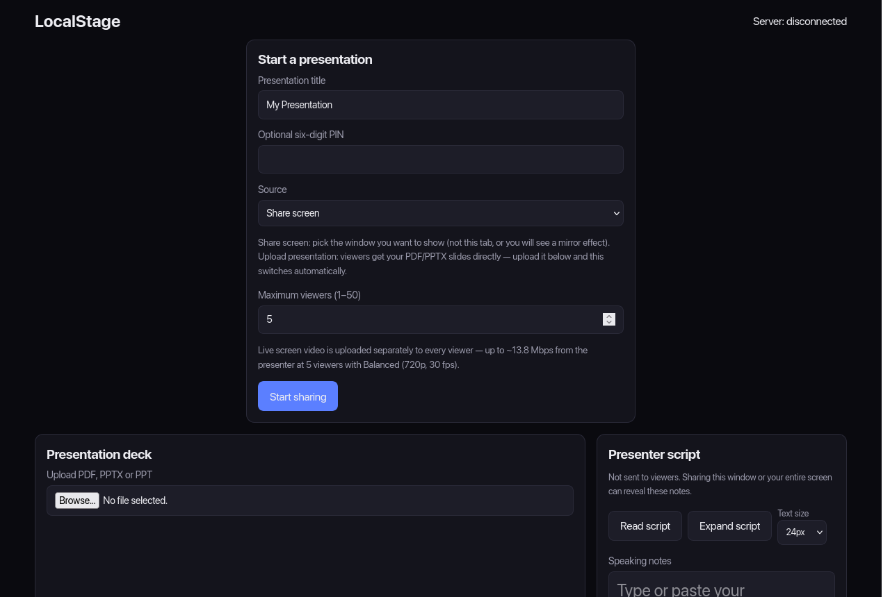
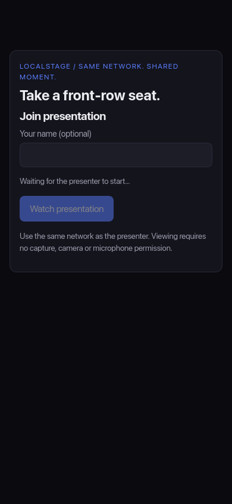

<div align="center">

# 🎤 LocalStage

**Your slides on every phone in the room. No internet needed.**

[](https://github.com/eendor/localstage-presenter/releases/latest)
[](https://github.com/eendor/localstage-presenter/actions)
[](https://github.com/eendor/localstage-presenter/releases)
<br>





</div>

## 🚀 Get started in 30 seconds

1. **[Download](https://github.com/eendor/localstage-presenter/releases/latest)** the file for your device.
2. Start it:
   - 🪟 Windows: double-click `LocalStage-windows.exe` (no install, no unzip)
   - 🍎 Mac: unzip, double-click `start.command`
   - 🐧 Linux: unzip, run `./start.sh`
   - 🤖 Android: install [`localstage-android.apk`](localstage-android.apk) and open **LocalStage**

   Windows may show "Windows protected your PC" the first time: click **More info → Run anyway**. On a Mac, right-click `start.command` → **Open** the first time.
3. Show the QR code to your audience. They scan it, and they're in. 🎉

> 💡 **Nothing to install.** PDF slides work right away. PowerPoint (.pptx) works too: LocalStage draws the slides itself, or uses [LibreOffice](https://www.libreoffice.org/) for best quality if it's installed. Or just export your slides to PDF.
>
> 👥 **Your audience installs nothing either.** They only need a web browser: phone, tablet or laptop, any brand.

## 🤖 Presenting from an Android phone

Install [`localstage-android.apk`](localstage-android.apk) (or from the [releases page](https://github.com/eendor/localstage-presenter/releases/latest)). Android may ask you to allow installs from your browser or Files app.

1. Open **LocalStage**. The presenter screen appears with the join QR code.
2. Tap **Choose slides** and pick a **PDF or PowerPoint (.pptx)**. The phone turns it into slides by itself. (Or **Share** a PDF to LocalStage from any app.)
3. Tap **Start presentation** and swipe through your slides.

Tip: turn on your phone's **hotspot** and have people join it. LocalStage notices the hotspot by itself and updates the QR code. That works anywhere, even with no Wi-Fi around. Screen sharing isn't available on Android, so present a PDF.

## 🤔 What it's for

LocalStage turns your laptop or Android phone into a small presentation server for the room you're in. You start it and get a link and a QR code. People scan it with their phone or laptop and see your slides or your screen live in their browser. Nothing leaves your local network.

It's meant for situations where the usual options don't fit:

- **No projector, or a bad one.** Everyone follows along on their own screen instead of squinting at the wall.
- **No internet, or internet you can't trust.** Video calls and cloud slide links need the internet. LocalStage only needs a shared Wi-Fi or hotspot, even one with no internet connection.
- **No sign-ups.** Viewers don't install an app or create an account. They open a link.
- **Privacy.** Your slides and screen go straight from your computer to the viewers' browsers over the local network. No third-party server sees them.

## 🎯 Use cases

- **Classrooms and workshops:** students follow slides on their phones and can flip back to an earlier slide when you allow it.
- **Meetups and small talks:** in a café, a meeting room or a hackathon without an HDMI cable.
- **Team meetings:** walk through a document or a demo on your screen without setting up a call.
- **Offline events:** field trainings, rural schools, or venues with no internet, using a phone hotspot.
- **Accessibility:** people at the back of the room or with low vision can zoom in on their own device.
- **Rehearsing:** read your speaker notes in the presenter script panel while viewers see only the slides.

## 🎬 Two ways to present

| Mode | What viewers see | When to use it |
|---|---|---|
| **Upload a deck** (PDF, PPTX, PPT) | Sharp slide images, which you advance from your laptop or phone | Slide presentations. No screen capture is needed and it uses very little bandwidth. Portrait PDFs are fitted automatically. |
| **Share screen** (computers only) | A live video of a window or your whole screen | Live demos, documents, anything that isn't a slide deck. |

## ⚠️ Good to know

- The presenter and viewers must be on the same network.
- Up to 50 viewers. Screen sharing sends a separate video stream to each viewer, so with many viewers a deck works better.

## 📡 Trouble connecting?

- Make sure viewers use `http://` and port `:3000` (e.g. `http://192.168.1.x:3000/join`), or scan the QR code.
- If on Wi-Fi with client isolation, switch the presenter to a phone hotspot.
- See **[docs/NETWORK.md](docs/NETWORK.md)** for firewall, VPN, and Wi-Fi troubleshooting tips.

## 🛠️ For developers

```
src/      C server
web/      the browser page (built into the server)
tests/    end-to-end tests  ->  make test
scripts/  launchers
docs/     guides and screenshots
```

Building from source, settings and how it works inside: see **[docs/TECHNICAL.md](docs/TECHNICAL.md)**.

## 🙏 Credits

- Original app: [dizshh/localstage-presenter](https://github.com/dizshh/localstage-presenter). This fork rewrites it in C.
- Live video: [WebRTC](https://webrtc.org/), built into every modern browser.
- PDF slides: [PDF.js](https://mozilla.github.io/pdf.js/) by Mozilla (Apache 2.0), built in.
- PowerPoint slides: [pptx-renderer](https://github.com/aiden0z/pptx-renderer) (Apache 2.0) and [html2canvas](https://html2canvas.hertzen.com/) (MIT), built in.
- PowerPoint slides: [LibreOffice](https://www.libreoffice.org/).
- Badges: [Shields.io](https://shields.io/).

<div align="center"><sub>Made for rooms with bad projectors and no Wi-Fi password. ✨</sub></div>
